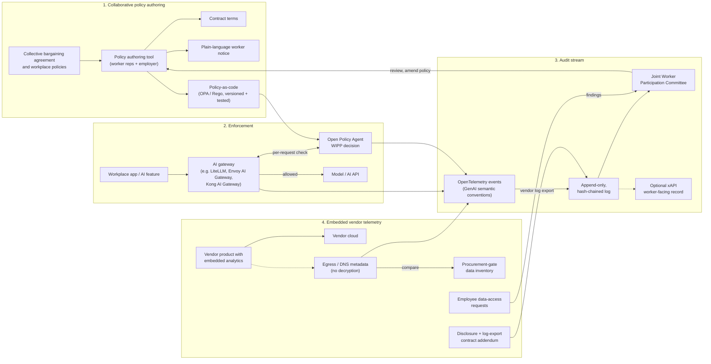

# WIPP Reference Architecture

**Status:** Active development (v1.1, October 2026)  
**Scope:** How the participation commitments in the [WIPP Clause](../WIPP-CLAUSE.md) can be turned into working policy, enforced at runtime, and audited by the Joint Worker Participation Committee.

> **Sees what passes through, sees where the rest goes, contracts for what remains.**

The architecture has four parts:

1. **Collaborative policy authoring**: workers and employers write the policy together.
2. **Enforcement via an AI gateway**: AI traffic that passes through a gateway is checked against that policy on every request.
3. **Audit stream**: every decision is recorded in a tamper-evident log the committee can read.
4. **Embedded vendor telemetry**: for data that never passes through the gateway, we observe where it goes and use contracts and data-access rights to cover what can't be observed.

It is built from existing open-source components and open standards wherever possible. It does **not** use TLS interception or traffic decryption.

---

## Overview

---

## 1. Collaborative policy authoring

**Goal:** One shared source of truth, co-authored by worker representatives and the employer, that produces both the human-readable agreement and the machine-enforceable rules.

- **Inputs:** collective bargaining agreement (CBA) language on technology, monitoring, discipline, scheduling, and data; existing workplace policies; the outputs of the [Joint Impact Assessment](../impact-assessment-template.md).
- **Process:** worker representatives (selected through union or democratic workplace processes, per WIPP requirement (a)) and employer representatives draft and review policy together. Every change is versioned with author, rationale, and approval status, which becomes part of the **WIPP Record**.
- **Outputs, generated from the same source:**
  - **Contract terms**: clause language suitable for a CBA, side letter, or procurement contract.
  - **Plain-language worker notice**: what the system does, what data it uses, what it may not be used for, and how to raise a concern. It should be available in the languages spoken at the workplace.
  - **Policy-as-code**: rules expressed in [Open Policy Agent](https://www.openpolicyagent.org/) (Rego), with test cases derived from the agreed terms.

The inXsol policy authoring tool is one implementation of this step. Any tool, or a disciplined document-plus-repository workflow, can fill the same role as long as the three outputs stay in sync and changes require joint approval.

See the [CBA-to-policy walkthrough](../examples/cba-to-policy-walkthrough.md) for a worked, illustrative example.

## 2. Enforcement via an AI gateway

**Goal:** Apply the agreed policy to AI traffic at the point where it already flows, without building a new interception layer.

- **Route model and AI API traffic through an existing open-source AI gateway**, for example [LiteLLM](https://github.com/BerriAI/litellm), [Envoy AI Gateway](https://aigateway.envoyproxy.io/), or [Kong AI Gateway](https://konghq.com/products/kong-ai-gateway). Many organizations already run one for cost control, key management, or model routing.
- **WIPP policy check per request.** The gateway calls OPA (through an external-authorization, guardrail, or plugin hook, depending on the gateway) with request context such as:
  - calling system and its approval status (WIPP requirement (d))
  - declared purpose (e.g. scheduling, safety alert, performance review)
  - data categories involved (e.g. location, biometric, productivity metrics)
  - whether a named human reviewer is attached for high-stakes uses
  - the AI knowledge sources in use (prompts, retrieval data) and their approved versions
- **Decision outcomes:** allow, deny, or allow-with-obligations (e.g. require human review, strip specific fields, attach a worker notice reference).
- **Policy-as-code properties:**
  - **Versioned**: each policy bundle has a version tied to the WIPP Record entry that approved it.
  - **Testable**: unit tests encode the agreed terms so that a change that breaks a negotiated protection fails before deployment.
  - **Reviewable**: worker representatives (or an advisor they choose) can read the rules and the tests, not just a vendor summary.

**What this layer does not do:** it does not decrypt or inspect traffic it is not already a party to. Traffic that bypasses the gateway is covered by part 4.

## 3. Audit stream

**Goal:** Give the Joint Worker Participation Committee a record of what the system actually did, which it can trust and read without depending on the vendor.

- **Event format:** each gateway decision is emitted as an [OpenTelemetry](https://opentelemetry.io/) event using the [GenAI semantic conventions](https://opentelemetry.io/docs/specs/semconv/gen-ai/) (model, operation, provider, token usage) plus `wipp.*` attributes (policy version, decision, reasons, purpose, data categories). Prompt and response content is **not** logged by default; logging content is a negotiated decision.
- **Storage:** events are written to an **append-only, hash-chained log**. Each record carries the hash of the previous record, so deletion or alteration is detectable. Periodic checkpoint hashes can be shared with the committee or a third party.
- **Access:** the committee has read access to the log and to summary reports (denials, overrides, policy changes, unusual volumes). Access to individual-level records follows the privacy terms in the agreement.
- **Worker-facing record (optional):** where workers should see their own interactions, such as training or safety acknowledgements, events can also be expressed as [xAPI](https://xapi.com/) statements in a learning record store.

## 4. Embedded vendor telemetry

**Problem:** Many workplace products send analytics, often tagged with personal information, directly from the product to the vendor's cloud. This traffic never passes through the AI gateway.

The architecture addresses it in four layers:

| Layer | What it does | What it relies on |
|---|---|---|
| **Contractual disclosure and log export** | Vendor discloses categories of data collected, destinations, retention, and sub-processors; provides regular export of telemetry logs to the committee. | [Vendor Telemetry Addendum](../clauses/vendor-telemetry-addendum.md) |
| **Egress / DNS metadata observation** | Observe destination domains, IPs, volumes, and timing from DNS and firewall/flow logs the employer already has. **No decryption.** | Existing network logs; emitted into the audit stream |
| **Procurement-gate data inventory** | Before purchase, the vendor's declared data flows are recorded. Observed egress is checked against that inventory, and undeclared destinations are flagged to the committee. | WIPP requirement (d); Impact Assessment |
| **Employee data-access rights** | Where applicable law provides access rights (e.g. CCPA/CPRA for California employees, GDPR in the EU), access requests are used as an audit step to compare what the vendor holds with what was disclosed. | Applicable privacy law; requests made voluntarily by workers |

Together: **the gateway sees what passes through, egress metadata shows where the rest goes, and contracts cover what remains.**

---

## Limitations

This architecture reduces risk. It does not eliminate it. Known limits:

- **Coverage depends on routing.** The gateway only enforces policy on traffic sent through it. Systems that call models directly, or vendors that run AI inside their own cloud, are outside runtime enforcement.
- **Metadata is not content.** Egress and DNS observation shows *where* data goes and *how much*, not *what* it contains. Encrypted DNS, shared CDNs, and vendor-side processing limit what can be inferred.
- **Contracts depend on vendor good faith and leverage.** Log exports are only as complete as the vendor makes them. Smaller buyers may have limited negotiating power.
- **Policy-as-code captures only what can be stated precisely.** Many negotiated protections, such as "not the sole basis for discipline," also require human process, training, and grievance procedures. Code supports these; it does not replace them.
- **Declared purpose can be wrong.** Per-request checks rely partly on the calling system declaring its purpose and data categories accurately; this needs periodic verification.
- **Data-access rights vary.** Rights differ by jurisdiction, employer size, and data type, and responses can be slow or incomplete. Using them as an audit step requires workers' voluntary participation and should never be required.
- **Audit logs carry their own privacy risk.** A detailed log of AI use is itself sensitive workplace data. Access, retention, and minimization must be negotiated.
- **Not legal advice.** Legal references are examples. Parties should get qualified advice for their jurisdiction.

## Status

The components are under active development as open-source reference material in this repository: policy bundles and tests, gateway integration examples, an audit event schema, and a hash-chain verifier. See the [Roadmap](../ROADMAP.md). Contributions and pilot feedback are welcome; open an issue.

---

**License**: This work is released under [CC-BY-4.0](https://creativecommons.org/licenses/by/4.0/).  
You are free to adapt and use it with attribution to:  
**inXsol LLC** — [WorkerInformedAI](https://github.com/nphoenix/WorkerInformedAI)

